<p>
<picture>
  <source media="(prefers-color-scheme: light)" srcset="assets/banner/hero-v2-light.svg">
  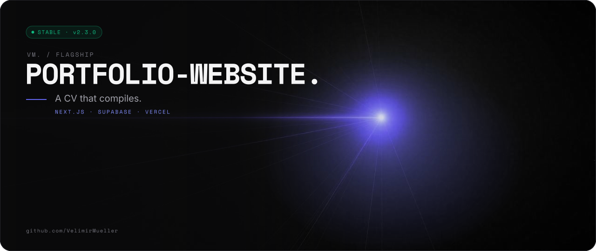
</picture>
</p>

<p>
<picture>
  <source media="(prefers-color-scheme: light)" srcset="assets/readme/lead-v2-light.svg">
  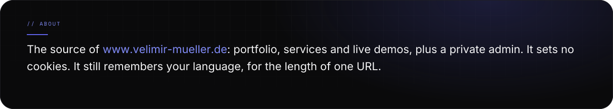
</picture>
</p>

<p>
<picture>
  <source media="(prefers-color-scheme: light)" srcset="assets/readme/stats-v2-light.svg">
  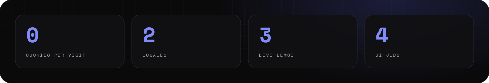
</picture>
</p>

<br>

<p>
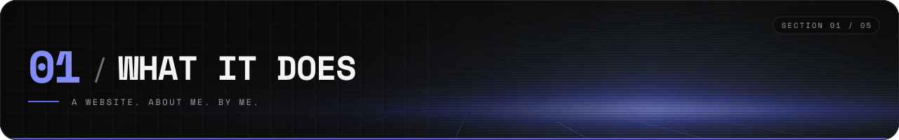
</p>

<p>
<picture>
  <source media="(prefers-color-scheme: light)" srcset="assets/readme/features-v2-light.svg">
  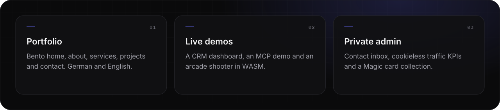
</picture>
</p>

<p>
<picture>
  <source media="(prefers-color-scheme: light)" srcset="assets/readme/what-v2-light.svg">
  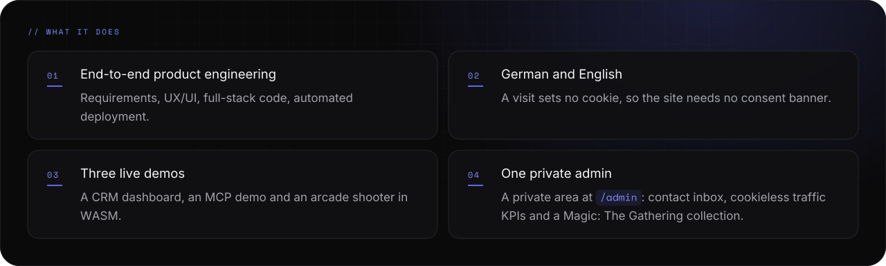
</picture>
</p>

<br>

<p>
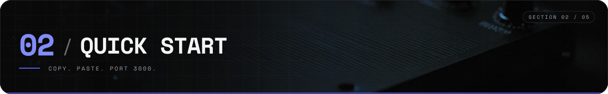
</p>

<p>
<picture>
  <source media="(prefers-color-scheme: light)" srcset="assets/readme/start-v2-light.svg">
  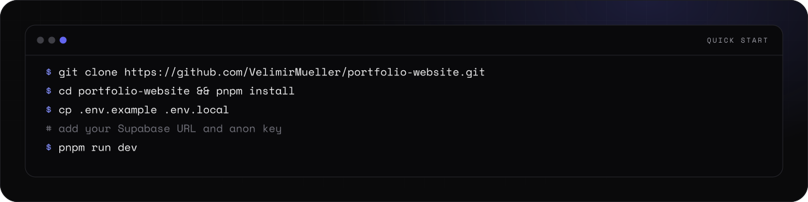
</picture>
</p>

<details>
<summary><picture><source media="(prefers-color-scheme: light)" srcset="assets/readme/links-7-v2-light.svg"></picture></summary>

```bash
git clone https://github.com/VelimirMueller/portfolio-website.git
cd portfolio-website
npm install
cp .env.example .env.local   # add your Supabase URL and anon key
npm run dev
```

</details>

<p>
<picture>
  <source media="(prefers-color-scheme: light)" srcset="assets/readme/devnotes-v2-light.svg">
  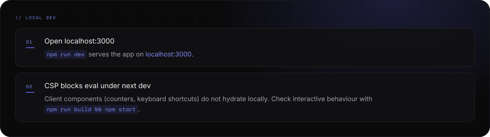
</picture>
</p>

<br>

<p>
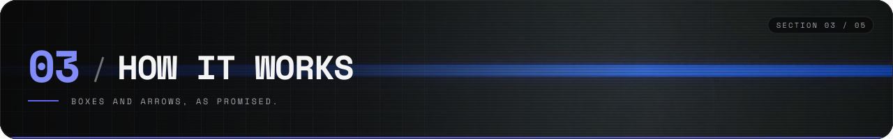
</p>

<p>
<picture>
  <source media="(prefers-color-scheme: light)" srcset="assets/readme/flow-v2-light.svg">
  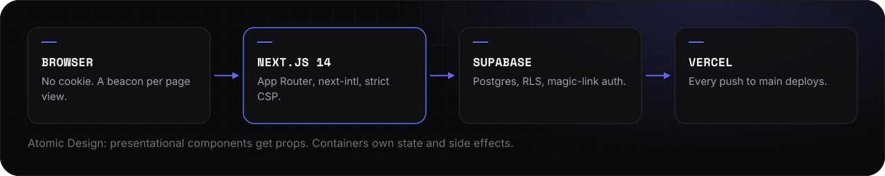
</picture>
</p>

<p>
<picture>
  <source media="(prefers-color-scheme: light)" srcset="assets/readme/layers-v2-light.svg">
  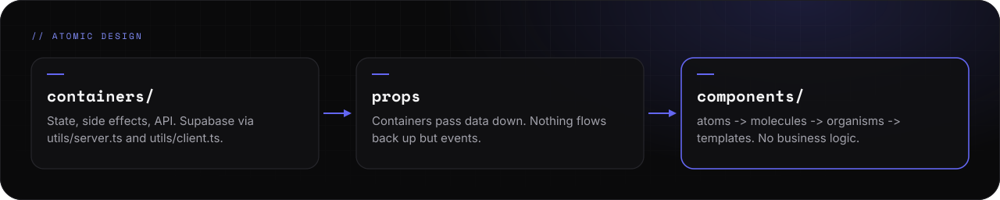
</picture>
</p>

<p>
<picture>
  <source media="(prefers-color-scheme: light)" srcset="assets/readme/how-v2-light.svg">
  
</picture>
</p>

<br>

<p>
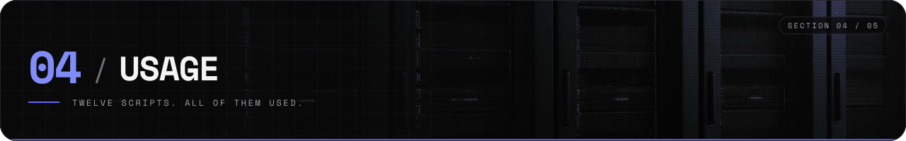
</p>

<p>
<picture>
  <source media="(prefers-color-scheme: light)" srcset="assets/readme/scripts-v2-light.svg">
  
</picture>
</p>

<p>
<picture>
  <source media="(prefers-color-scheme: light)" srcset="assets/readme/testing-v2-light.svg">
  
</picture>
</p>

<p>
<picture>
  <source media="(prefers-color-scheme: light)" srcset="assets/readme/commits-v2-light.svg">
  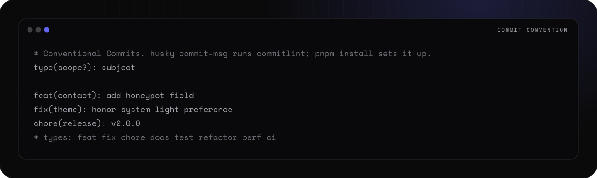
</picture>
</p>

<p>
<picture>
  <source media="(prefers-color-scheme: light)" srcset="assets/readme/admin-v2-light.svg">
  
</picture>
</p>

<p>
<picture>
  <source media="(prefers-color-scheme: light)" srcset="assets/readme/deploy-v2-light.svg">
  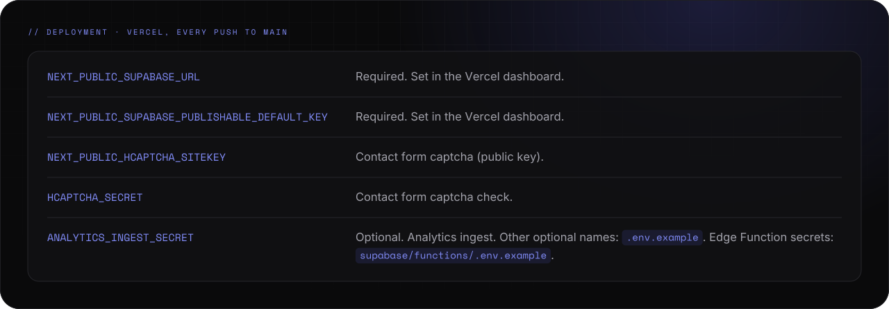
</picture>
</p>

<p align="center">
<a href="https://playwright.dev/"><picture><source media="(prefers-color-scheme: light)" srcset="assets/readme/links-8-v2-light.svg">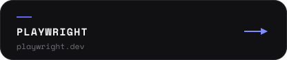</picture></a>
<a href="https://storybook.js.org/"><picture><source media="(prefers-color-scheme: light)" srcset="assets/readme/links-9-v2-light.svg"></picture></a>
<a href="https://www.conventionalcommits.org/"><picture><source media="(prefers-color-scheme: light)" srcset="assets/readme/links-10-v2-light.svg">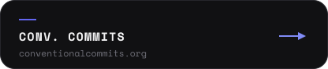</picture></a>
</p>

<details>
<summary><picture><source media="(prefers-color-scheme: light)" srcset="assets/readme/links-7-v2-light.svg"></picture></summary>

```bash
npm test                                      # all unit tests
npm run test:visual -- --update-snapshots     # new visual baselines
npm run test:e2e -- --grep "Navigation"       # one E2E group
npm run storybook                             # localhost:6006
```

```text
type(scope?): subject

feat(contact): add honeypot field
fix(theme): honor system light preference
chore(release): v2.0.0
```

```text
NEXT_PUBLIC_SUPABASE_URL
NEXT_PUBLIC_SUPABASE_PUBLISHABLE_DEFAULT_KEY
```

</details>

<br>

<p>
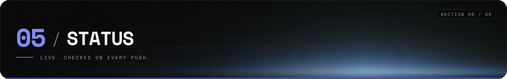
</p>

<p>
<picture>
  <source media="(prefers-color-scheme: light)" srcset="assets/readme/status-v2-light.svg">
  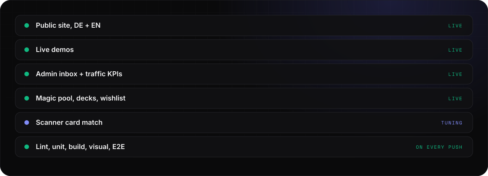
</picture>
</p>

<p>
<picture>
  <source media="(prefers-color-scheme: light)" srcset="assets/readme/ci-v2-light.svg">
  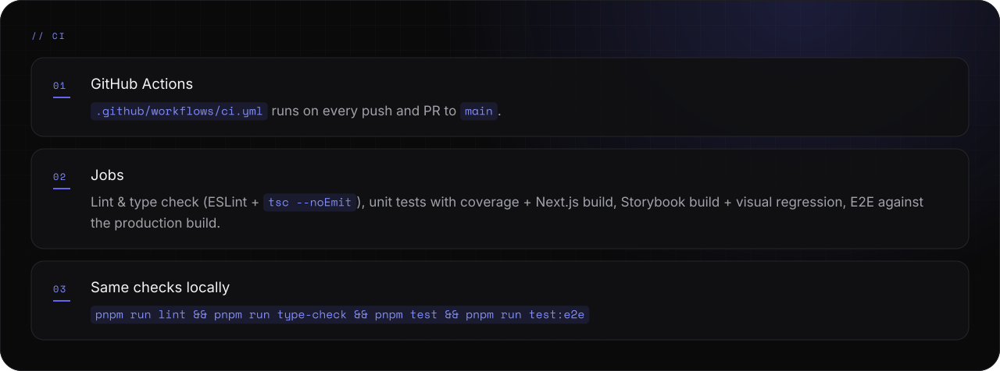
</picture>
</p>

<p align="center">
<a href="docs/REFERENCE.md"><picture><source media="(prefers-color-scheme: light)" srcset="assets/readme/links-1-v2-light.svg"></picture></a>
<a href="https://github.com/VelimirMueller/portfolio-website/actions"><picture><source media="(prefers-color-scheme: light)" srcset="assets/readme/links-2-v2-light.svg">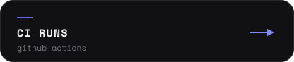</picture></a>
<a href="https://www.velimir-mueller.de"><picture><source media="(prefers-color-scheme: light)" srcset="assets/readme/links-3-v2-light.svg">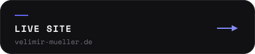</picture></a>
</p>

<p align="center">
<a href="https://www.linkedin.com/in/velimir-m%C3%BCller-07b460175"><picture><source media="(prefers-color-scheme: light)" srcset="assets/readme/links-4-v2-light.svg"></picture></a>
<a href="mailto:velimir.mueller@googlemail.com"><picture><source media="(prefers-color-scheme: light)" srcset="assets/readme/links-5-v2-light.svg">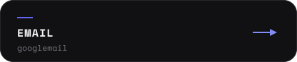</picture></a>
<a href="https://github.com/VelimirMueller"><picture><source media="(prefers-color-scheme: light)" srcset="assets/readme/links-6-v2-light.svg"></picture></a>
</p>

<p>
<picture>
  <source media="(prefers-color-scheme: light)" srcset="assets/readme/footer-v2-light.svg">
  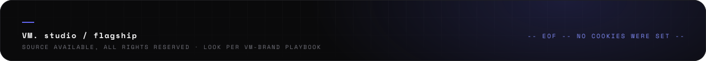
</picture>
</p>
